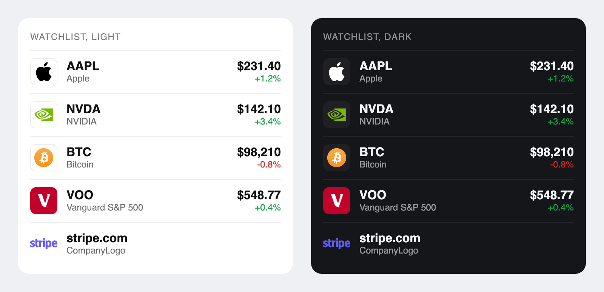

# react-stock-logo

React stock logo component. Show the logo for any stock ticker, ETF or crypto coin with one line, or a company logo from its domain. Light and dark, square tiles for lists, free, no API key.



## For developers

```bash
npm install react-stock-logo
```

```jsx
import { StockLogo, CompanyLogo } from 'react-stock-logo';

<StockLogo ticker="AAPL" theme="dark" shape="square" size={32} />
<CompanyLogo domain="stripe.com" />
```

Each component renders a plain `` that points at a hosted `logoapi.sh` URL. The package has no runtime dependency except [stock-ticker-logos](https://www.npmjs.com/package/stock-ticker-logos), which builds the URL. React is a peer dependency (16.8 or newer). ESM, CommonJS and TypeScript types are included.

Dark background? Add `theme="dark"`. Light is the default.

| Prop | Component | Default | Notes |
| --- | --- | --- | --- |
| `ticker` | StockLogo | required | Stock, ETF or coin symbol, any case: AAPL, VOO, BTC |
| `domain` | CompanyLogo | required | `stripe.com`, `www.` and `https://` are fine |
| `theme` | both | `light` | `dark` for dark backgrounds |
| `shape` | StockLogo | none | `square` gives an always 1:1 tile, best for watchlists |
| `size` | both | `32` | Sets `width` and `height` in px |
| `alt` | both | `AAPL logo` | Override for your own wording |
| `domain` | StockLogo | none | Optional. If the logo fails to load, the site favicon is shown |

Behavior:

- `loading="lazy"`, `decoding="async"`, `width` and `height` set, so the page does not jump.
- If the image fails, it falls back to the favicon route (`https://logoapi.sh/favicon/{domain}`) when a domain is known, then to a letter tile. Your own `onError` still runs first.
- Any other `` prop (`className`, `style`, `title`) passes through.
- Need only the URL? `import { srcFor } from 'react-stock-logo'` returns the hosted URL string.

Plain URL, no React needed:

```html


```

Light and dark: `https://logoapi.sh/ticker/AAPL.svg` and `https://logoapi.sh/dark/ticker/AAPL.svg`. Square tile: add `?shape=square`.

Free tier stays free: we give [12 months' notice](https://logoapi.sh/terms) before it is reduced or removed. No key, no attribution. More at [logoapi.sh](https://logoapi.sh).

## License

MIT for the code. Logos are trademarks of their owners.
